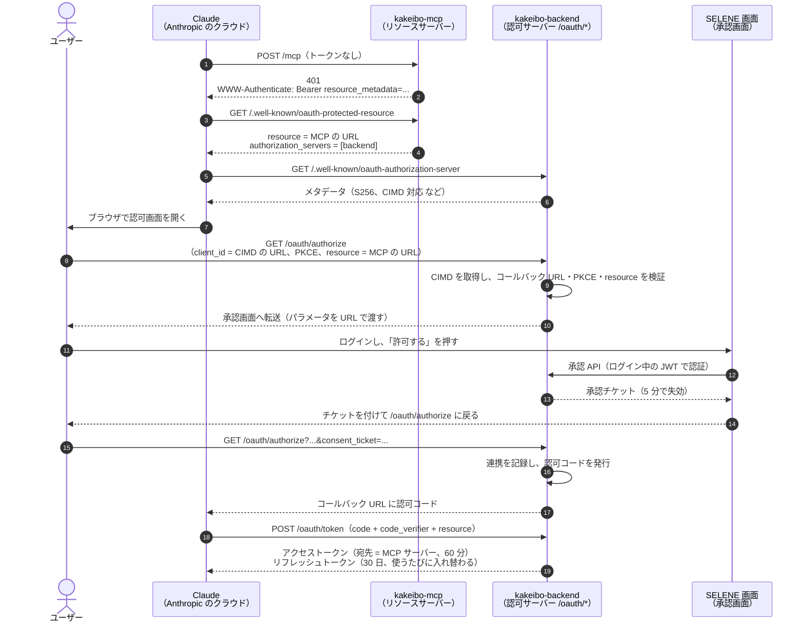
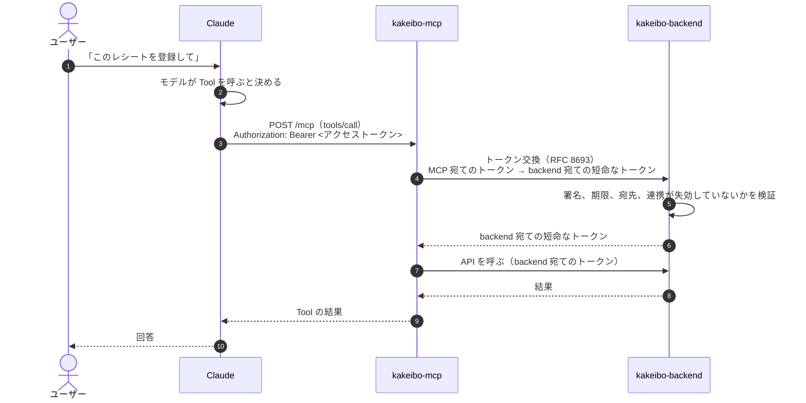

# MCP クライアントの OAuth 接続の設計

Claude アプリ（Web・スマホ・デスクトップ）のカスタムコネクタなど、MCP クライアントから、ユーザーごとに自分の SELENE アカウントで接続できるようにする設計（#100）。

**決定：SELENE の backend を OAuth の認可サーバーにする（下の「案 A」）。** 決め手は「MCP サーバーは薄いほどよい」こと。MCP サーバーは AI と SELENE の間の通訳に徹し、認証の状態も秘密情報も持たない。

関連する文書:

- [oauth-authorization-server.md](oauth-authorization-server.md)：backend の認可サーバーの実装（エンドポイント、承認画面との受け渡し、設定、鍵）
- [api-key-auth.md](api-key-auth.md)：API キー認証（OAuth と共存する）
- selene-mcp-server の [docs/architecture.md](https://github.com/Riri-Inferno/selene-mcp-server/blob/develop/docs/architecture.md)：MCP サーバーの構成と、リソースサーバーとしての役割

この文書の仕様は、一次ソース（MCP の公式仕様、Claude の公式ドキュメント、ライブラリのソース）に基づく。出典は末尾に記載する。一次ソースで確認できなかったことは「未確認」と書く。

## なぜ OAuth が必要か

- MCP サーバー（`https://mcp-kakeibo.riri-inferno.com/mcp`）は、`Authorization: Bearer slk_...`（API キー）を付ければ使える。Claude Code はヘッダーを設定できるので、すでに使えている
- Claude アプリのカスタムコネクタでは、個人のアカウントはヘッダーを設定できない
  - ヘッダーで固定の認証情報を送る方式（`static_headers`）は、組織の Owner が設定するもので、ベータ版のため限られた組織しか使えない [[C2]](https://claude.com/docs/connectors/building/authentication)
  - その方式でも「組織の認証情報として扱い、個人の認証情報として扱わない。ツールが個々のユーザーとして動く必要があるなら OAuth を使う」とされている [[C2]](https://claude.com/docs/connectors/building/authentication)
- OAuth なら、ユーザーはコネクタを追加するときに SELENE にログインして許可するだけでよい。API キーを手で発行して貼る必要がなく、ほかの人もそれぞれ自分のアカウントでつなげる

## 全体の流れ

流れは、起きるタイミングの違う 3 つの場面に分かれる。

| 場面 | いつ | 人間の操作 |
|---|---|---|
| ① 接続する | コネクタを追加したとき、1 回だけ | ブラウザで SELENE にログインし、「許可する」を押す |
| ② Tool を呼ぶ | 人間が指示し、モデルが Tool を呼ぶたび | なし |
| ③ トークンを更新する | アクセストークンの期限（60 分）の少し前 | なし |

### ① 接続する

承認チケットが必要な理由：SELENE のログイン状態はフロントエンドが持つ JWT にあり、ブラウザが `/oauth/authorize` に来るときには付いてこない。そこで、承認画面が JWT で承認 API を呼んでチケットを受け取り、チケットを付けて戻る。詳しくは [oauth-authorization-server.md](oauth-authorization-server.md)。

### ② Tool を呼ぶ

MCP サーバーが受け取ったトークンをそのまま backend に渡さず交換するのは、MCP の仕様で禁止されているため（受け取ったトークンを上流の API に転送してはならない：MUST NOT）。交換したトークンで使えるのは、API キーで使えるエンドポイントと同じ範囲（詳細は [oauth-authorization-server.md](oauth-authorization-server.md) の「連携経由の API 呼び出し」）。

### ③ トークンを更新する

Claude は、アクセストークンの期限の 5 分前から、または 401 を受けたときに、リフレッシュトークンで新しいトークンに取り替える [[C2]](https://claude.com/docs/connectors/building/authentication)。リフレッシュトークンは使うたびに新しいものに入れ替わる（ローテーション）ので、30 日以内に一度でも使っていれば、①をやり直す必要はない。

### トークンの種類

| トークン | 誰が持つ | 宛先 | 期限 |
|---|---|---|---|
| セッションの JWT（既存） | SELENE の画面 | SELENE | 15 分（リフレッシュは 7 日） |
| OAuth のアクセストークン | Claude | MCP サーバー | 60 分 |
| OAuth のリフレッシュトークン | Claude | 認可サーバー | 30 日。使うたびに入れ替わる |
| 交換したトークン | MCP サーバー（使い捨て） | SELENE の API（`selene-api-oauth`） | 5 分 |

- セッションの JWT を Claude に渡すことはない
- 宛先の違うトークンを使い分けるのは、「受け取ったトークンを上流に転送しない」を守るため

### API キーで接続する方式との共存

API キーで接続する方式（Claude Code など、ヘッダーを設定できるクライアント）は、今の仕組みのまま残す。MCP サーバーは、受け取ったトークンが `slk_` で始まれば今までどおり backend に転送し、それ以外は OAuth のトークンとして交換に回す。

## 満たす必要がある要件

### Claude のカスタムコネクタ [[C1]](https://claude.com/docs/connectors/building)[[C2]](https://claude.com/docs/connectors/building/authentication)[[C3]](https://support.claude.com/en/articles/11175166-getting-started-with-custom-connectors-using-remote-mcp)

| 項目 | 要件 |
|---|---|
| 対応する仕様の版 | 2025-03-26、2025-06-18、2025-11-25 |
| クライアント登録 | DCR（RFC 7591）、CIMD、Anthropic が持つクライアント情報、ユーザーが入力するクライアント情報 のいずれか。DCR と CIMD は「デフォルトでサポート」 |
| CIMD を使う条件 | 認可サーバーのメタデータに `"client_id_metadata_document_supported": true` と、`token_endpoint_auth_methods_supported` に `"none"` があること。なければ DCR にフォールバックする |
| コールバック URL | `https://claude.ai/api/mcp/auth_callback`（Web・デスクトップ・スマホ）。Claude Code はループバック（`http://localhost:<任意のポート>/callback` など） |
| 401 の応答 | `WWW-Authenticate` に `resource_metadata` を付けた 401 を返す。`authorization_servers` は先頭の 1 件だけを使う |
| PKCE | S256 が必須 |
| トークンの更新 | 401 を受けたとき、または有効期限の 5 分前から更新する。リフレッシュトークンのローテーションと、`invalid_grant` などの RFC 6749 のエラーコードが必要 |
| トークンエンドポイント | `application/x-www-form-urlencoded` を受け付ける |
| タイムアウト | メタデータ、登録、トークンのエンドポイントは 10 秒、更新は 30 秒、Tool の呼び出しは 240 秒 |
| 接続元 | 端末ではなく Anthropic のクラウド（スマホも同じ）。IP は `160.79.104.0/21` |
| ポート | 443 のみ |
| 利用できるプラン | Free 以上（Free はカスタムコネクタ 1 つまで） |

### MCP の仕様（最新版 2026-07-28）[[S1]](https://modelcontextprotocol.io/specification/latest/basic/authorization)

Claude が対応しているのは 2025-11-25 版までだが、最新版にも合わせておく。

- MCP サーバーは Protected Resource Metadata（RFC 9728）を提供しなければならない（MUST）。`authorization_servers` を含める
- 認可サーバーは RFC 8414 か OpenID Connect Discovery のメタデータを提供する（MUST）。`issuer` はメタデータの URL と完全に一致させる。`code_challenge_methods_supported` に `S256` を含める
- **MCP サーバーは、トークンが自分宛て（audience）に発行されたことを検証しなければならない（MUST）**
- **MCP サーバーは、受け取ったトークンを上流の API にそのまま転送してはならない（MUST NOT）**
- 無効・期限切れのトークンは 401。スコープ不足は 403 と `error="insufficient_scope"`
- クライアント登録は、CIMD が推奨（SHOULD）。DCR は非推奨になり、互換のために残されている（MAY）
- 公開クライアントのリフレッシュトークンはローテーションする（MUST）。アクセストークンは短命にする（SHOULD）
- `offline_access` を `scopes_supported` に載せない（SHOULD NOT）
- 認可レスポンスに `iss` を含める（SHOULD、RFC 9207）

## 設計の選択肢

### 最初に考えていた案と、その問題

最初は「MCP サーバーを MCP の TypeScript SDK の部品で認可サーバーにし、承認されたら API キーを発行して、それをアクセストークンとして返す」案を考えていた。この案には次の問題がある。

- トークンの実体が API キーで、MCP サーバーはそれを backend にそのまま転送する。**トークンの転送禁止（MUST NOT）に当たる**
- トークンの宛先が MCP サーバーではなく backend なので、**宛先の検証（MUST）もできない**
- 頼りにする SDK の認可サーバー部品は、v2 で `@modelcontextprotocol/server-legacy/auth` に移されて凍結された。新しく作るなら専用の認可サーバーを使うよう案内されている [[K1]](https://github.com/modelcontextprotocol/typescript-sdk/tree/v1.x/src/server/auth)[[K2]](https://ts.sdk.modelcontextprotocol.io/v2/serving/authorization.html)

### 案 A：SELENE の backend を認可サーバーにする（採用）

backend が OAuth の認可サーバーになり、MCP サーバー宛てのトークンを発行する。MCP サーバーはそのトークンを backend で交換して、backend 宛ての短命なトークンで API を呼ぶ。

- 良い点
  - ユーザー、ログイン（Google / GitHub）、DB、リフレッシュトークンのローテーションは backend にすでにある
  - MCP サーバーはステートレスのまま。署名の鍵も持たない
  - 転送禁止と宛先の検証を、仕様どおりに満たせる
  - 承認した連携を backend の DB に記録するので、SELENE の画面で「Claude と連携中」と一覧にして、失効もできる（#107）
- 気になる点
  - backend に追加する機能が多い（メタデータ、`/oauth/authorize`、`/oauth/token`、CIMD、承認画面、トークン交換）
  - トークン交換のエンドポイントを外に出さない必要がある（Cloudflare Tunnel で `/internal/` を塞いだ）
  - Tool を呼ぶたびに、backend への呼び出しが 1 回増える

### 案 B：MCP サーバーを認可サーバーにし、独自のトークンを発行する

MCP サーバーが SDK v1 の `mcpAuthRouter` で認可サーバーになる。承認されたら backend に API キーを発行してもらい、MCP サーバーはそれを保存する。クライアントには別の独自のトークンを渡す。

- 良い点：backend の変更は少ない。上流に渡すのは MCP サーバー自身が持つ API キーなので、転送禁止には当たらない
- 気になる点：MCP サーバーが状態と秘密情報（API キー）を持ち、DB か Redis が要る。認証の仕組みが 2 か所に分かれる。SDK の部品は v2 で凍結されている

### 案 C：外部の認証基盤を使う（Keycloak、Auth0 など）

SDK v2 が案内している方式。

- 良い点：OAuth の実装を自分で持たなくてよい
- 気になる点：認証基盤のユーザーと SELENE のユーザーを対応付ける必要がある。raspi5 で Keycloak を動かすのは重く、SaaS にすると外部への依存が増える。backend を呼ぶための交換は、結局どこかで必要になる
- Google をそのまま認可サーバーにする形も考えられるが、採らない
  - GitHub でログインしているユーザーが使えない
  - Google のトークンは Google の API 宛てで、MCP サーバー宛てにならない。結局、案 A と同じ対応付けと交換が要る
  - Claude に Google の OAuth クライアント ID と secret を手で入力してもらう方式になる
  - 案 A でも、承認画面のログインには Google / GitHub をそのまま使う。違うのは、MCP 用のトークンを誰が発行するかだけ

### 比較

| | 案 A：backend が認可サーバー | 案 B：MCP サーバーが認可サーバー | 案 C：外部の認証基盤 |
|---|---|---|---|
| 仕様への適合 | ◎ | ○ | ◎ |
| MCP サーバーのステートレス | ◎ | ×（DB が要る） | ◎ |
| MCP サーバーの秘密情報 | △（交換の方式による） | ×（API キーを保存） | △ |
| 実装量 | 大（backend） | 中 | 中〜大（連携と運用） |
| 既存資産の活用 | ◎ | ○ | △ |
| 連携の一覧と失効 | ◎（backend の DB） | ○ | △ |

## 認可サーバーの実装：OpenIddict

backend（ASP.NET Core）の認可サーバーには [OpenIddict](https://github.com/openiddict/openiddict-core)（7.9.0）を使う。OAuth のプロトコルそのもの（認可コード、PKCE、トークンの発行、ローテーション、再利用の検知、メタデータ）は OpenIddict が担い、SELENE 固有の部分（CIMD、承認チケット、メタデータの調整）を書き足す。

- 採用の理由：Apache 2.0 で無料。トークン交換（RFC 8693）が 7.0 から標準で入っている [[O2]](https://kevinchalet.com/2025/07/07/openiddict-7-0-is-out/)。PKCE の必須化と、リフレッシュトークンのローテーションがある
- Duende IdentityServer は採らない：本番の利用は有料で、`resource` パラメータ（RFC 8707）は上位プランにしかない [[O3]](https://docs.duendesoftware.com/general/licensing/)
- 前提：OpenIddict の EF Core 連携は EF Core 8 以上が必要。backend を .NET 10 と EF Core 10 に上げて満たした（#103）

必要な機能が実現できるかは、OpenIddict 7.9.0 のソースで確かめた [[O1]](https://github.com/openiddict/openiddict-core/tree/7.9.0)。

| 必要なこと | 結果 | 根拠（`src/` からのパス） |
|---|---|---|
| `/.well-known/oauth-authorization-server` でメタデータを返す | 標準で対応 | `OpenIddict.Server/OpenIddictServerOptions.cs`：設定エンドポイントの既定に `.well-known/openid-configuration` と `.well-known/oauth-authorization-server` の両方がある |
| メタデータに項目を追加・削除する | 拡張で対応 | `OpenIddictServerHandlers.Discovery.cs`：メタデータはハンドラで組み立てられる。`AddEventHandler` で独自のハンドラを足せる |
| `resource` の値をトークンの宛先（`aud`）に入れる | 対応 | `OpenIddictServerHandlers.Authentication.cs`：登録済みの値以外を `invalid_target` で拒否する。`OpenIddictServerHandlers.cs`：アクセストークンの `aud` は、承認時に設定した resources から作られる |
| 認可レスポンスに `iss` を含める（RFC 9207） | 標準で対応 | `OpenIddictServerHandlers.Discovery.cs`：`authorization_response_iss_parameter_supported` を true で返す |
| URL 形式の client_id（CIMD）を受け付ける | 拡張で対応 | `OpenIddict.Core/Managers/OpenIddictApplicationManager.cs`：`FindByClientIdAsync` が virtual。`ReplaceApplicationManager` で差し替える |
| 認可エンドポイントで SELENE のログインにつなぐ | 対応 | `OpenIddict.Server.AspNetCore/OpenIddictServerAspNetCoreBuilder.cs`：`EnableAuthorizationEndpointPassthrough` |
| リフレッシュトークンのローテーション | 既定で有効 | `OpenIddictServerBuilder.cs`：`DisableRollingRefreshTokens` のコメントに、無効にすることは推奨しないとある |
| PKCE の必須化、トークン交換 | 対応 | `OpenIddictServerBuilder.cs`：`RequireProofKeyForCodeExchange`、`AllowTokenExchangeFlow` |

実装で決めたことと動作確認の結果は [oauth-authorization-server.md](oauth-authorization-server.md) にまとめた。設計に関わるものは次のとおり。

- **クライアント登録は CIMD のみ**（DCR には対応しない）。Claude も Claude Code も CIMD に対応している。Claude Code の CIMD は `https://claude.ai/oauth/claude-code-client-metadata` [[C2]](https://claude.com/docs/connectors/building/authentication)
- **resource は MCP サーバーのエンドポイントの URL（`https://mcp-kakeibo.riri-inferno.com/mcp`）にする**。OpenIddict は resource を文字列の完全一致で照合し、パスのない URL には末尾に `/` を足して正規化するため。MCP サーバーの Protected Resource Metadata の `resource` も同じ値にする（#109）
- **鍵**：OpenIddict は署名に非対称鍵（RSA など）を必須とする。リリース環境では、RSA 秘密鍵と暗号化用の共通鍵を Secret で渡す（#110）

## CIMD（Client ID Metadata Document）

- クライアント（Claude なら Anthropic）が、自分の情報（名前、コールバック URL など）を書いた JSON を HTTPS の URL で公開し、その URL をクライアント ID として使う
- 認可サーバーはその URL から JSON を取得し、`client_id` が URL と一致するか、認可リクエストのコールバック URL が JSON の中のものと一致するかを確かめる
- secret はない。信頼の根拠は、ドメインの所有者だけが JSON を置けること、認可コードは JSON に書かれたコールバック URL にしか返らないこと、PKCE で横取りしたコードが使えないこと
- 事前の登録（DCR）が要らない

## よくある疑問

- **個人のアカウントで作れるか**：作れる。カスタムコネクタは Free 以上のプランで使え [[C3]](https://support.claude.com/en/articles/11175166-getting-started-with-custom-connectors-using-remote-mcp)、OAuth（DCR と CIMD）は「デフォルトでサポート」されている [[C2]](https://claude.com/docs/connectors/building/authentication)
- **業務システムで、組織で 1 つのキーを使う場合**：`static_headers` を使い、組織の Owner がコネクタを追加するときにキーを入力する。ベータ版で、限られた組織しか使えない [[C2]](https://claude.com/docs/connectors/building/authentication)。Team / Enterprise では、Owner がコネクタを組織に追加し、メンバーはそれぞれ接続する [[C3]](https://support.claude.com/en/articles/11175166-getting-started-with-custom-connectors-using-remote-mcp)
- **同じ Claude アカウントで、端末ごとに接続が必要か**：接続は端末からではなく Anthropic のクラウドから行われる [[C3]](https://support.claude.com/en/articles/11175166-getting-started-with-custom-connectors-using-remote-mcp) ので、アカウント単位で 1 回になると考えられる。ただし「Web で追加したコネクタがスマホにも出る」ことは明記されていない（**未確認**。#110 で確かめる）。Claude Code は別で、端末ごとに設定する
- **別々の Claude アカウントが、同時に同じ MCP サーバーを使えるか**：使える。MCP サーバーはリクエストごとにトークンを受け取って処理し、セッションを持たない
  - OAuth の場合：Claude アカウントごとに SELENE にログインして承認し、別々のトークンを受け取る。2 人が同じ SELENE アカウントで承認すれば、トークンは別々でも同じ家計簿を共有する。片方の連携だけを失効させられる
  - API キーの場合：同じキーを両方に設定しても使える。ただし、どちらからの呼び出しかは区別できず、失効させると両方が止まる

## 未決事項

- Cloudflare の Bot Fight Mode が Claude からの接続を止める場合は、`160.79.104.0/21` を WAF で除外する。最新の IP 範囲は [[C4]](https://platform.claude.com/docs/en/api/ip-addresses) で確認する → #110
- Web で追加したコネクタが、スマホのアプリにも出るか（**未確認**）→ #110

解決済み:

- アクセストークンの形式：OpenIddict の既定（暗号化された JWT）。MCP サーバーは中身を読まず、交換のときに backend が検証する
- クライアント登録の方式：CIMD のみ。Claude Code も CIMD に対応している
- トークン交換のエンドポイントの守り方：`/internal/` 以下を Cloudflare Tunnel で外に出さない。MCP サーバーに秘密情報は持たせない（交換できるのは有効なアクセストークンを持つ場合だけで、権限は広がらない）
- 承認画面：読み取りは必須、書き込みは選べる（クライアントが求めている場合だけ、既定でオン）。連携の一覧と解除は、設定画面に API キーとは別のセクションとして置いた

## 出典

- [S1] MCP 仕様 Authorization（2026-07-28）: https://modelcontextprotocol.io/specification/latest/basic/authorization
- [C1] Claude: Building connectors: https://claude.com/docs/connectors/building
- [C2] Claude: Authentication: https://claude.com/docs/connectors/building/authentication
- [C3] Claude ヘルプ: Getting started with custom connectors using remote MCP: https://support.claude.com/en/articles/11175166-getting-started-with-custom-connectors-using-remote-mcp
- [C4] Claude API の IP アドレス: https://platform.claude.com/docs/en/api/ip-addresses
- [K1] MCP TypeScript SDK v1 の認可サーバー部品: https://github.com/modelcontextprotocol/typescript-sdk/tree/v1.x/src/server/auth
- [K2] MCP TypeScript SDK v2 の Authorization: https://ts.sdk.modelcontextprotocol.io/v2/serving/authorization.html
- [O1] OpenIddict（ソース。7.9.0 のタグで確認）: https://github.com/openiddict/openiddict-core/tree/7.9.0
- [O2] OpenIddict 7.0 リリース記事（トークン交換）: https://kevinchalet.com/2025/07/07/openiddict-7-0-is-out/
- [O3] Duende IdentityServer のライセンス: https://docs.duendesoftware.com/general/licensing/
