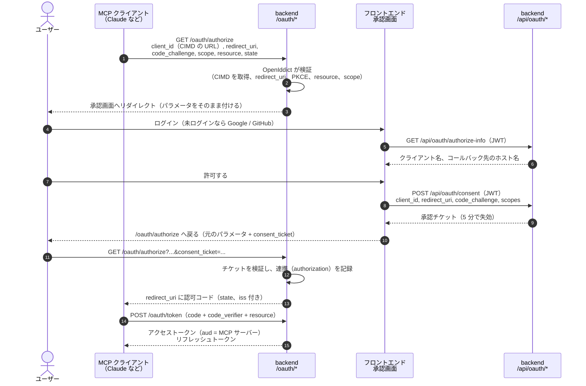
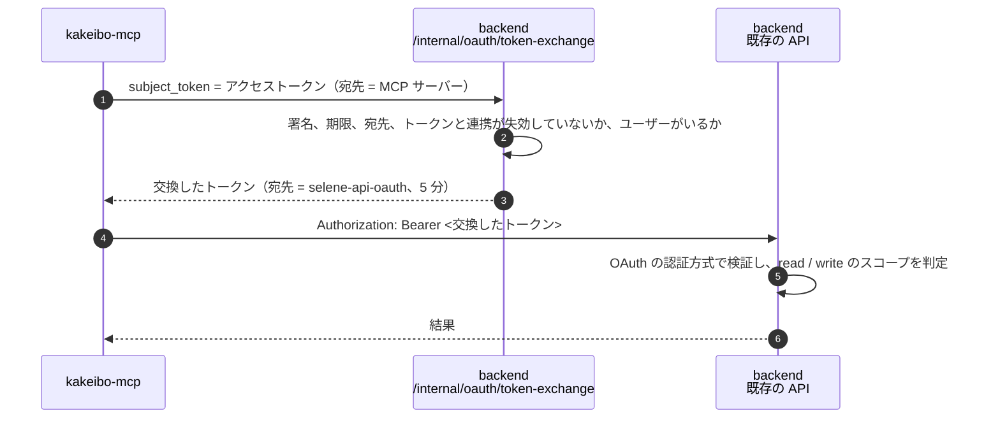

# OAuth 認可サーバー

Claude アプリ（Web・スマホ・デスクトップ）のカスタムコネクタなど、MCP クライアントがユーザーごとに SELENE へ接続できるように、backend を OAuth 2.1 の認可サーバーにする（#100、#106）。

- 全体の流れ、方式を選んだ理由、満たす仕様（MCP Authorization、Claude のコネクタの要件）は [mcp-oauth-design.md](mcp-oauth-design.md) を参照
- 実装には [OpenIddict](https://github.com/openiddict/openiddict-core)（7.9.0）を使う

## 既存の認証への影響

ない。

- 認証の既定のスキーム（JwtBearer）は変えない。OpenIddict は自分のエンドポイント（`/oauth/*`、`/.well-known/*`）だけを処理する
- OpenIddict が発行したアクセストークンでは、既存の API は使えない。OpenIddict.Validation はトークン交換のときの検証にだけ使い、ASP.NET Core の認証スキームとしては登録しない
- 連携経由で API を呼ぶ認証方式（`OAuth`）を 1 つ足した。API キーと同じエンドポイントだけで使え、ログインした本人の JWT とは区別される（下記「連携経由の API 呼び出し」）
- DB は OpenIddict のテーブルを 4 つ追加するだけ（`OpenIddictApplications`、`OpenIddictAuthorizations`、`OpenIddictScopes`、`OpenIddictTokens`）
  - テーブルの定義（エンティティの型と列の設定）は OpenIddict の NuGet パッケージ（`OpenIddict.EntityFrameworkCore.Models`）にあり、`Infrastructure/Data/Entities` には置いていない。`Program.cs` の `opts.UseOpenIddict()` で `ApplicationDbContext` のモデルに加わり、マイグレーション（`AddOpenIddict`）は EF で生成した
  - 主キーは OpenIddict の既定の `string` で、SELENE のエンティティ（`Guid`、`BaseEntity`）とは揃えていない。このテーブルは OpenIddict の Manager からしか読み書きしないため
  - OpenIddict のメジャーバージョンを上げてテーブルの定義が変わった場合は、`dotnet ef migrations add` で差分のマイグレーションを作る
- `OAuth` の設定がそろっていなければ、認可サーバーは有効にならない

## エンドポイント

| パス | 内容 |
|---|---|
| `GET /.well-known/oauth-authorization-server` | メタデータ（RFC 8414）。`/.well-known/openid-configuration` でも同じ内容を返す |
| `GET /.well-known/jwks` | 署名の公開鍵 |
| `GET/POST /oauth/authorize` | 認可エンドポイント。OpenIddict が検証したあと、`OAuthAuthorizationController` で承認画面との受け渡しをする |
| `POST /oauth/token` | トークンエンドポイント。認可コードとリフレッシュトークンを OpenIddict が処理する |
| `GET /api/oauth/authorize-info` | 承認画面に表示するクライアントの情報（JWT のみ） |
| `POST /api/oauth/consent` | 連携を許可し、承認チケットを返す（JWT のみ。API キーや連携経由では不可） |
| `GET /api/oauth/connections` | 連携中のアプリの一覧（JWT のみ） |
| `DELETE /api/oauth/connections/{id}` | 連携を解除し、その連携のトークンもすべて失効させる（JWT のみ） |
| `POST /internal/oauth/token-exchange` | MCP サーバー向けのトークン交換（RFC 8693 の形式）。Cloudflare Tunnel で外部からは届かない |

メタデータの主な内容:

- `code_challenge_methods_supported`: `S256` のみ（PKCE は必須。`plain` は受け付けない）
- `grant_types_supported`: `authorization_code`、`refresh_token`
- `scopes_supported`: `read`、`write`（OpenIddict が自動で加える `offline_access` と `openid` は外す。下記）
- `client_id_metadata_document_supported`: `true`、`token_endpoint_auth_methods_supported` に `none`（Claude はこの 2 つがそろうと CIMD を使う）
- `authorization_response_iss_parameter_supported`: `true`（RFC 9207）

## 認可の流れ

SELENE のログイン状態は、フロントエンドが持つ JWT にある。ブラウザが `/oauth/authorize` に来るときには JWT が付いてこないので、承認画面と認可エンドポイントの間を **承認チケット** でつなぐ。

- ユーザーが拒否した場合、フロントエンドは `consent_denied=1` を付けて `/oauth/authorize` に戻る。クライアントには `access_denied` が返る
- 承認チケットは、`client_id`・`redirect_uri`・`code_challenge` に紐づけている。別の認可リクエストには使えず、認可コードを受け取っても `code_verifier` がなければトークンに交換できない
- 承認チケットは JWT の秘密鍵（`Authentication:Jwt:SecretKey`）で署名する。宛先（`aud`）を `selene-oauth-consent` にして、ログイン用の JWT とは区別する

## クライアントの登録（CIMD）

Client ID Metadata Document に対応する。DCR（RFC 7591）には対応しない（MCP の仕様で非推奨）。

- `client_id` がパス付きの HTTPS の URL なら、その URL から JSON を取得して検証し、OpenIddict のアプリケーションとして登録する（`ClientIdMetadataDocumentApplicationManager`）
- 検証すること
  - JSON の `client_id` が、取得した URL と完全に一致する
  - `redirect_uris` が HTTPS か、ループバック（localhost / 127.0.0.1）の HTTP
  - `token_endpoint_auth_method` が `none` か未指定（secret を持たない公開クライアントだけを受け付ける）
- 登録した内容は 24 時間たったら取得し直す。取得に失敗したら前回の内容を使う
- 取得するときは、リダイレクトに従わない。接続先がプライベートなアドレス（ループバック、10.0.0.0/8 など）なら接続しない（SSRF 対策）。5 秒で打ち切り、64 KB を超える文書は受け付けない
- コールバック URL がすべてループバックのクライアント（Claude Code など）は native として登録する。OpenIddict は native のときだけ、ループバックのポート違いを許す（RFC 8252）
- 登録するクライアントには、MCP サーバーの URL（`OAuth:McpResource`）を resource として使う許可を付ける。設定が変わって許可が足りなくなったクライアントは、CIMD を取得し直して付け直す
- Claude Code の CIMD は `https://claude.ai/oauth/claude-code-client-metadata`（[Claude のドキュメント](https://claude.com/docs/connectors/building/authentication) に記載）。コールバック URL は `http://localhost/callback` と `http://127.0.0.1/callback`

## トークン

| トークン | 有効期間 | 備考 |
|---|---|---|
| 認可コード | OpenIddict の既定（5 分） | 1 回だけ使える。2 回使われたら、その連携で発行したトークンをすべて失効させる（コードが盗まれた場合の対策） |
| アクセストークン | 60 分（`OAuth:AccessTokenLifetimeMinutes`） | `aud` は MCP サーバー（`OAuth:McpResource`）。暗号化されていて、MCP サーバーは中身を読まない |
| リフレッシュトークン | 30 日（`OAuth:RefreshTokenLifetimeDays`） | 使うたびに新しいものに入れ替わる（ローテーション）。同時に更新した場合のため、使い終わったものも 30 秒だけ使える（OpenIddict の既定） |

- OpenIddict は、`offline_access` スコープが付いたときだけリフレッシュトークンを発行する。MCP の仕様では `offline_access` を公開しないほうがよい（SHOULD NOT）ので、メタデータには載せず、承認したときにサーバー側で付ける
- 承認した連携は `OpenIddictAuthorizations` に記録する。連携を失効させると、その連携で発行したトークンもまとめて使えなくなる（失効の画面は #107）

## 設定

`OAuth` セクション（環境変数では `OAuth__*`）。`Backend/.env.example` も参照。

| 設定 | 内容 |
|---|---|
| `Issuer` | 認可サーバーの issuer。例: `https://api-kakeibo.riri-inferno.com/` |
| `McpResource` | MCP サーバーのエンドポイントの URL（パスまで含める）。例: `https://mcp-kakeibo.riri-inferno.com/mcp` |
| `ConsentPageUrl` | 承認画面の URL。例: `https://kakeibo.riri-inferno.com/oauth/consent` |
| `SigningKey` | 署名用の RSA 秘密鍵（PEM）。OpenIddict は非対称鍵を必須とする |
| `EncryptionKey` | 暗号化用の共通鍵（256 bit の Base64） |
| `AccessTokenLifetimeMinutes` / `RefreshTokenLifetimeDays` | トークンの有効期間 |

- `Issuer`・`McpResource`・`ConsentPageUrl` の 3 つがそろったときだけ有効になる。そろっていなければ `/oauth/*` などは 404 になる
- `McpResource` は、クライアントが送る `resource` パラメータと**文字列として完全に一致**しないと拒否される。OpenIddict は URL を正規化するため、パスのない URL（`https://mcp-kakeibo.riri-inferno.com`）は末尾に `/` が付いて一致しなくなる。MCP の仕様の例どおり、エンドポイントの URL（`/mcp` 付き）にする。MCP サーバーの Protected Resource Metadata の `resource` も同じ値にする（#109）
- 鍵は、Development では未設定でもよい（起動ごとに一時的な鍵を作るので、再起動すると発行済みのトークンは使えなくなる）。それ以外の環境では、未設定だと起動に失敗する
- リリース環境に出すときは、鍵を Secret（home-raspi-iac の SealedSecret）に追加する必要がある（#110）
- TLS は Cloudflare で終端し、クラスタ内は HTTP で届くため、OpenIddict の HTTPS 必須のチェックは外している。公開される URL は `Issuer` から作るので https になる

## 動作確認（ローカル）

Claude Code の公開 CIMD を client_id に使い、次の 26 項目を確かめた（2026-11-25）。

- 正常系：承認画面へのリダイレクト、クライアント情報の取得（「Claude Code」と表示される）、承認チケット、認可コード（`state` と `iss` 付き、ループバックのポート違いも可）、トークンの発行、リフレッシュ
- ローテーション：使い終わったリフレッシュトークンは 30 秒の猶予を過ぎると拒否される。認可コードが再利用されると、その連携のトークンも失効する
- 拒否されること：PKCE の `plain`、PKCE なし、登録していない `resource`、CIMD にないコールバック URL、登録されていない client_id、別の認可リクエストのチケット、ユーザーの拒否、`write` だけの承認、API キーや認証なしでの承認 API
- 既存の認証：JWT と API キーは変わらず使える。OAuth のアクセストークンでは既存の API は使えない（交換は #108）
- `OAuth` の設定がない場合：`/oauth/*`・メタデータ・承認 API は 404、既存の認証は変わらない

## 連携経由の API 呼び出し（トークン交換）

MCP サーバーは、Claude などから受け取ったアクセストークン（宛先 = MCP サーバー）をそのまま backend に渡してはならない（MCP の仕様で MUST NOT）。そこで、Tool を呼ぶたびに backend で交換してから API を呼ぶ（#108）。

- **交換したトークン**：ログイン用の JWT と同じ鍵で署名した JWT。宛先（`aud`）を `selene-api-oauth` にして、ログイン用の JWT（`Authentication:Jwt:Audience`）とは区別する。クレームはユーザー、テナント、連携の ID、client_id、スコープ（`scope`）
- **認証方式 `OAuth`**：交換したトークンを受け付ける JwtBearer のスキーム。`JwtOrApiKeySchemes`（API キーで使えるエンドポイント）に加えたので、**使えるエンドポイントは API キーと同じ**。画面専用の API（`[Authorize(AuthenticationSchemes = "Bearer")]`：API キーの発行、連携の承認・一覧・解除など）は使えない
- **スコープ**：`ApiKeyScopeHandler` が、API キーと同じく `scope` クレームで read / write を判定する。不足していれば 403 と理由（「連携で許可されたスコープが不足しています」）を返す
- **個人情報**：API キーと同じく、ユーザー設定からメールアドレスと画像の URL を返さない（`IsDelegatedAccess`）
- **連携の解除はすぐに反映される**：交換のたびに、OpenIddict の検証で連携とトークンの状態を確かめるため。交換したトークン（最長 5 分）は解除後も期限までは使えるが、MCP サーバーはリクエストごとに交換するので、実際には次の Tool の呼び出しから使えなくなる
- **`/internal/` を外に出さない**：Cloudflare Tunnel（home-raspi-iac の cloudflared の ingress）で、`api-kakeibo` の `/internal/` 以下を 404 にしている。MCP サーバーはクラスタ内の URL で呼ぶ。仮に外から届いても、交換できるのは有効なアクセストークンを持っている場合だけで、得られる権限はそのトークンと同じなので、権限が広がることはない。MCP サーバーに秘密情報を持たせないために、クライアント認証はしていない

## 承認画面と連携の一覧（フロントエンド）

- `/oauth/consent`（`pages/OAuthConsent.vue`）：backend から転送されてくる承認画面
  - 未ログインなら、ログイン画面に移り、ログイン後に元の画面（パラメータ付き）へ戻る（`utils/postLoginRedirect.ts`。GitHub ログインでいったん外に出るので sessionStorage に保存する）
  - クライアント名と、認可コードを返す先のホスト名をはっきり表示する（なりすまし対策。MCP の仕様で MUST）
  - 読み取りは必須。書き込みはクライアントが求めているときだけ選べ、既定でオン（外せば読み取りだけの連携になる）
  - 許可したら承認チケットを受け取り、元のパラメータとチケットを付けて `/oauth/authorize` に戻る。許可しなければ `consent_denied=1` を付けて戻る
- 設定画面の「連携中のアプリ」（`components/organisms/OAuthConnectionSection.vue`）：API キーとは別のセクション。アプリ名、許可した日時、最後に使った日時、スコープ、解除ボタン
  - 最後に使った日時は、その連携で最後にトークンを発行した日時（アクセストークンは 60 分ごとに更新されるので、使っていればその頃の日時になる）
  - 同じアプリでも、接続し直すたびに別の連携として記録される

## まだやっていないこと

- Claude で実際に接続して確かめ、リリース環境に設定（鍵、MCP サーバーの環境変数）を入れる（#110）
